  

  
  
  
  

## 👋 About me

I'm a **senior frontend developer** with **9+ years** of professional experience, currently building cloud-service interfaces at [Cloud.ru](https://cloud.ru/).

- 🧩 I design and ship complex React + TypeScript interfaces — from architecture to the last pixel
- 🤖 I ship large tasks with AI coding agents and work on bringing AI into frontend development
- 🏡 Many years of effective remote work
- 🎲 Off-screen: travel and board games

## 🛠 Tech stack

**Core**

**State & data**

**Also worked with**

**Tooling & testing**

## 💼 What I do

<table>
  <tr>
    <td>🏗 <b>Frontend architecture</b></td>
    <td>Large React + TypeScript applications built as microfrontends: module boundaries, state and data layers, independent releases</td>
  </tr>
  <tr>
    <td>🎨 <b>Design systems</b></td>
    <td>Building a design system and shared UI libraries that keep products consistent and teams fast</td>
  </tr>
  <tr>
    <td>⚡ <b>Performance & quality</b></td>
    <td>Fast, accessible, well-tested interfaces; typed contracts with the backend</td>
  </tr>
  <tr>
    <td>🤝 <b>Engineering culture</b></td>
    <td>Code review, technical decisions, mentoring, clear standards the whole team can follow</td>
  </tr>
  <tr>
    <td>🤖 <b>AI-driven development</b></td>
    <td>Delivering large tasks with AI coding agents as part of the everyday workflow</td>
  </tr>
</table>

## 🎯 Current focus

**AI engineering** — bringing LLMs and agents into real products and frontend workflows.

  

